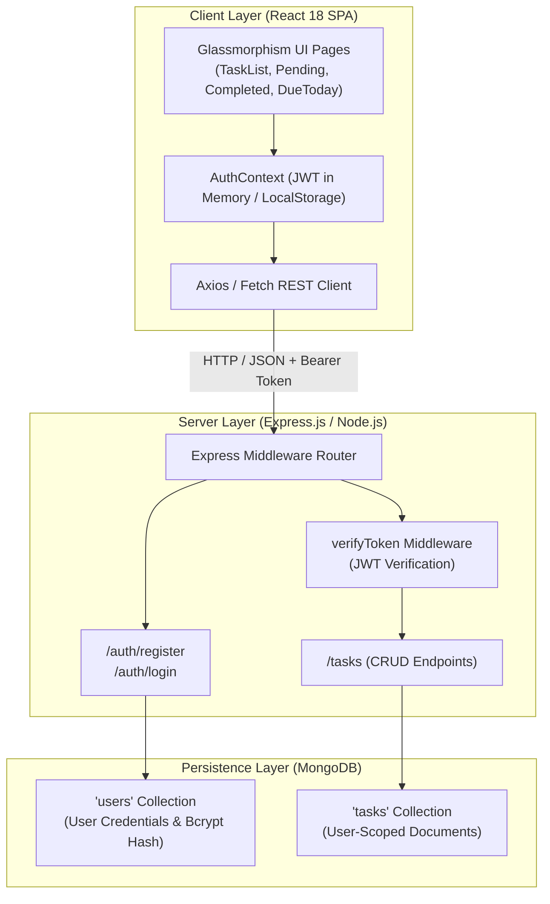

# 📝 MERN Task Manager — Full-Stack Web Application

[](https://reactjs.org/)
[](https://nodejs.org/)
[](https://expressjs.com/)
[](https://www.mongodb.com/)
[](https://jwt.io/)
[](https://www.docker.com/)
[](https://opensource.org/licenses/ISC)

A production-ready full-stack task management web application built on the **MERN** stack (MongoDB, Express.js, React, Node.js). Features stateless **JSON Web Token (JWT)** authentication, bcrypt password hashing, dynamic task filtering (All, Pending, Completed, Due Today), priority-based sorting, and optimistic UI updates with responsive glassmorphism design.

Developed as the **Capstone Project** for **Web Technologies (UE23CS202)** at **PES University**.

---

## ✨ Features & Architecture Highlights

- **🔐 Stateless Authentication**: Secure user registration and login issuing signed JSON Web Tokens (`jsonwebtoken`) with `bcryptjs` salt hashing.
- **📋 Full Task CRUD & State Management**: Create, read, update, and delete tasks with optimistic React state synchronization.
- **⚡ Filter & Due-Date Intelligence**:
  - **All Tasks View**: Complete overview with priority badges (High, Medium, Low).
  - **Pending Tasks**: Filter unfulfilled commitments.
  - **Completed Tasks**: Track finished milestones with instant status toggle.
  - **Due Today**: Automatic client-side date comparison highlighting pressing deadlines.
- **🛡️ Protected API Routes**: Express middleware (`verifyToken`) validating incoming `Authorization: Bearer <token>` headers.
- **🐳 Containerized Deployment**: Instant 1-command startup via Docker Compose (`docker-compose.yml`).

---

## 🗺️ System Full-Stack Architecture



---

## 📡 REST API Reference

All task endpoints require an `Authorization: Bearer <token>` header obtained via login.

| Method | Endpoint | Auth | Description | Request Body Payload |
| :--- | :--- | :---: | :--- | :--- |
| `POST` | `/auth/register` | ❌ | Create new user account | `{"username": "tanmayi", "password": "securepassword"}` |
| `POST` | `/auth/login` | ❌ | Authenticate & receive JWT token | `{"username": "tanmayi", "password": "securepassword"}` |
| `GET` | `/tasks` | ✅ | Fetch all tasks for current user | *None* |
| `POST` | `/tasks` | ✅ | Create a new task | `{"title": "Project Review", "description": "Prep demo", "priority": "High", "dueDate": "2026-11-20"}` |
| `PUT` | `/tasks/:id` | ✅ | Update task details / status | `{"completed": true}` |
| `DELETE` | `/tasks/:id` | ✅ | Delete a task by ID | *None* |

---

## 🚀 Quickstart & Setup

### Option A: 1-Command Startup (Docker Compose)
To run MongoDB and the backend automatically:
```bash
git clone https://github.com/Tanmayi-n14/webtech-mern-task-manager.git
cd webtech-mern-task-manager
docker compose up -d
```
Then start the React frontend:
```bash
cd frontend
npm install
npm start
```
*Access the app at `http://localhost:3000`.*

---

### Option B: Local Manual Setup

#### 1. Backend Setup
```bash
cd backend
npm install
```
Create a `.env` file in `backend/`:
```env
PORT=5000
MONGO_URI=mongodb://localhost:27017/taskmanager
JWT_SECRET=your-secret-key-here
```
Start the API server:
```bash
npm run dev
# Server running at http://localhost:5000
```

#### 2. Frontend Setup
In a separate terminal:
```bash
cd frontend
npm install
npm start
# Client running at http://localhost:3000
```

---

## 📂 Repository Contents

```text
webtech-mern-task-manager/
├── docker-compose.yml               # Container orchestration for MongoDB + Backend
├── backend/
│   ├── Dockerfile                   # Container build manifest for Node.js API
│   ├── server.js                    # Express app, JWT auth, MongoDB native driver logic
│   ├── package.json                 # Backend dependencies (express, mongodb, bcryptjs, jwt)
│   └── .env.example                 # Template for required environment variables
├── frontend/
│   ├── src/
│   │   ├── context/AuthContext.js   # Global auth state and JWT session management
│   │   ├── components/Navbar.js     # Responsive navigation header
│   │   ├── pages/                   # TaskList, Pending, Completed, DueToday, Login, Register
│   │   ├── App.js                   # Client-side routing with protected view gates
│   │   └── index.css                # Glassmorphism styling and responsive layout
│   └── package.json                 # Frontend dependencies (React 18, React Router)
└── README.md
```

---

## 👤 Author

* **Tanmayi Nagabhairava** ([@Tanmayi-n14](https://github.com/Tanmayi-n14)) — `PES1UG24CS493`
* Department of Computer Science & Engineering, PES University
